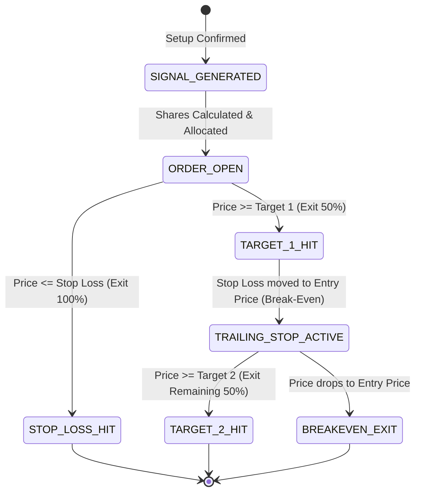
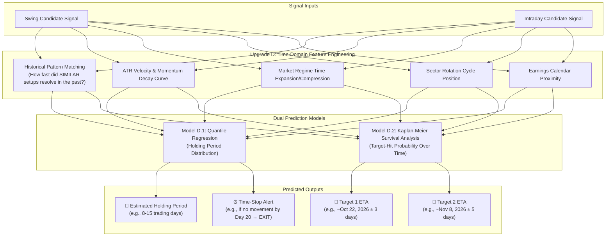
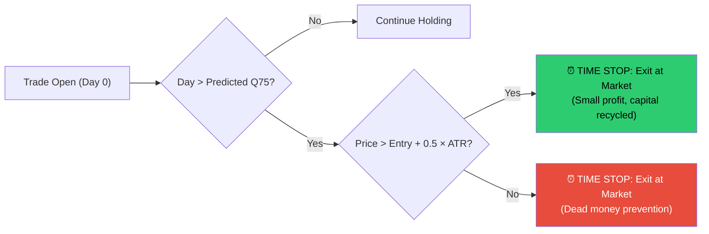

# Institutional Quantitative Architecture: Next-Level Upgrades Blueprint

**Author:** Quantitative Architecture & Strategy Engineering Team  
**Project:** AlphaSeeker AI Platform  
**Scope:** Complete Implementation Guide for Autonomous Execution, Machine Learning Meta-Labeling, and Alternative Data Intelligence  

---

## 1. System Interaction Architecture

```mermaid
flowchart TD
    subgraph S1 [Dynamic Ingestion & Core Generation]
        A1[Live Scrapers: SEC / NSE / Volume] --> A2[Market Regime Classifier]
        A2 --> A3[Technical Breakout Engines: Minervini & ORB]
    end

    subgraph S2 [Upgrade B: Quantitative ML Meta-Labeler]
        A3 --> B1[Candidate Trade Pool]
        B1 --> B2[Feature Matrix: Regimes, RVOL, Breadth, Volatility]
        B2 --> B3[LightGBM Meta-Label Classifier]
        B3 -->|Filter: P(Win) < 65%| B4[Rejected Low-Probability Setups]
        B3 -->|Approved: P(Win) >= 65%| B5[High-Conviction Alpha Signals]
    end

    subgraph S3 [Upgrade C: Alternative Data & LLM Synthesis]
        B5 --> C1[Options Chain & Dark Pool Flow Analyzer]
        B5 --> C2[LLM Earnings Transcript & 10-K Evaluator]
        C1 & C2 --> C3[Synthesized Institutional Trade Dossier]
    end

    subgraph S4 [Upgrade A: Autonomous Execution & Portfolio Ledger]
        C3 --> D1[24/7 Background Cron/Daemon Scheduler]
        D1 --> D2[Instant Telegram Push Notification]
        D1 --> D3[Virtual Paper Trading Ledger & SQLite DB]
        D3 --> D4[Automated Trailing Stops & Exit Management]
        D4 --> D5[Daily Mark-to-Market Equity Curve & Analytics]
    end
```

---

## 2. Upgrade A: Autonomous 24/7 Scheduler & Paper Trading Ledger

### 2.1 The Core Purpose
Transforms AlphaSeeker from a manual on-demand screener into an **autonomous trading desk** that runs continuously in the background, tracks position lifecycles, moves stops to break-even automatically, and maintains an auditable track record.

---

### 2.2 Daemon Architecture & Market Clock Awareness
Financial markets operate on strict time intervals. The scheduler must wake up and execute specific routines based on the active market session:

```mermaid
timeline
    title Daily Autonomous Execution Schedule
    Pre-Market (8:45 AM) : Scrape overnight news & macro yields : Filter top gap-up candidates
    Market Open (9:30 AM - 9:45 AM) : Run 15-Minute Opening Range Breakout (ORB) : Check RVOL > 2.0x surges : Push immediate Telegram alerts
    Mid-Day (12:00 PM) : Monitor active paper positions : Check if Target 1 reached : Auto-trail stop-loss to break-even
    Market Close (4:00 PM) : Run End-of-Day Minervini Stage 2 Swing scan : Calculate daily Mark-to-Market portfolio equity
    Post-Market (5:30 PM) : Dispatch Daily Performance & Portfolio Digest to Telegram
```

---

### 2.3 Relational Database Schema (`trading_ledger.db`)

We use SQLite via SQLAlchemy with three core tables:

```sql
-- 1. Active & Historical Orders
CREATE TABLE IF NOT EXISTS trades (
    id INTEGER PRIMARY KEY AUTOINCREMENT,
    ticker TEXT NOT NULL,
    timeframe TEXT NOT NULL,          -- 'SWING' or 'INTRADAY'
    direction TEXT NOT NULL,          -- 'LONG' or 'SHORT'
    status TEXT NOT NULL,             -- 'OPEN', 'PARTIAL_T1', 'CLOSED'
    entry_date TIMESTAMP NOT NULL,
    entry_price REAL NOT NULL,
    shares INTEGER NOT NULL,
    initial_stop REAL NOT NULL,
    current_stop REAL NOT NULL,
    target_1 REAL NOT NULL,
    target_2 REAL NOT NULL,
    exit_date TIMESTAMP,
    exit_price REAL,
    realized_pnl REAL DEFAULT 0.0,
    return_pct REAL DEFAULT 0.0,
    exit_reason TEXT                  -- 'TARGET_1', 'TARGET_2', 'STOP_LOSS', 'TIME_STOP'
);

-- 2. Daily Portfolio Equity Curve
CREATE TABLE IF NOT EXISTS portfolio_snapshots (
    id INTEGER PRIMARY KEY AUTOINCREMENT,
    timestamp TIMESTAMP NOT NULL,
    cash_balance REAL NOT NULL,
    invested_capital REAL NOT NULL,
    total_portfolio_value REAL NOT NULL,
    unrealized_pnl REAL NOT NULL,
    realized_pnl REAL NOT NULL,
    active_position_count INTEGER NOT NULL,
    drawdown_pct REAL NOT NULL
);

-- 3. Audit & System Action Logs
CREATE TABLE IF NOT EXISTS system_logs (
    id INTEGER PRIMARY KEY AUTOINCREMENT,
    timestamp TIMESTAMP NOT NULL,
    event_type TEXT NOT NULL,          -- 'SCAN', 'SIGNAL', 'ORDER_OPEN', 'STOP_TRAIL', 'ORDER_CLOSE'
    ticker TEXT,
    message TEXT NOT NULL
);
```

---

### 2.4 Position Lifecycle State Machine



---

### 2.5 Code Blueprint: `ledger/virtual_broker.py`

```python
from datetime import datetime
from typing import Optional
from dataclasses import dataclass

@dataclass
class PaperPosition:
    ticker: str
    entry_price: float
    shares: int
    current_stop: float
    target_1: float
    target_2: float
    t1_booked: bool = False

class VirtualBroker:
    def __init__(self, initial_capital: float = 10000.0):
        self.cash = initial_capital
        self.positions = {}
        self.history = []

    def open_position(self, ticket):
        cost = ticket.recommended_shares * ticket.entry_price
        if cost <= self.cash:
            self.cash -= cost
            self.positions[ticket.ticker] = PaperPosition(
                ticker=ticket.ticker,
                entry_price=ticket.entry_price,
                shares=ticket.recommended_shares,
                current_stop=ticket.stop_loss,
                target_1=ticket.target_1,
                target_2=ticket.target_2
            )
            return True
        return False

    def update_positions_on_bar(self, ticker: str, high: float, low: float, close: float):
        if ticker not in self.positions:
            return
        pos = self.positions[ticker]

        # 1. Stop Loss check
        if low <= pos.current_stop:
            exit_price = pos.current_stop
            pnl = (exit_price - pos.entry_price) * pos.shares
            self.cash += (pos.shares * exit_price)
            del self.positions[ticker]
            return {"event": "STOP_LOSS", "pnl": pnl}

        # 2. Target 1 check (50% partial exit + break-even trail)
        if not pos.t1_booked and high >= pos.target_1:
            pos.t1_booked = True
            half_shares = pos.shares // 2
            pnl = (pos.target_1 - pos.entry_price) * half_shares
            self.cash += (half_shares * pos.target_1)
            pos.shares -= half_shares
            pos.current_stop = pos.entry_price  # Risk-free trade
            return {"event": "TARGET_1_PARTIAL", "pnl": pnl}

        # 3. Target 2 check (Full exit)
        if high >= pos.target_2:
            pnl = (pos.target_2 - pos.entry_price) * pos.shares
            self.cash += (pos.shares * pos.target_2)
            del self.positions[ticker]
            return {"event": "TARGET_2_FULL", "pnl": pnl}
```

---

## 3. Upgrade B: LightGBM Machine Learning Meta-Labeler

### 3.1 The López de Prado Meta-Labeling Framework
In traditional quantitative finance, training machine learning models directly to predict raw prices (*"Will stock go up tomorrow?"*) fails because financial series have a near-zero Signal-to-Noise Ratio (SNR).

**Dr. Marcos López de Prado** (*"Advances in Financial Machine Learning"*) introduced the institutional solution: **Meta-Labeling**:
* **The Primary Model:** A high-recall rule-based technical strategy (Minervini Stage 2 or 15m ORB) scans 1,000 stocks and generates 20 possible trade triggers.
* **The Secondary ML Model (Meta-Labeler):** Does **NOT** predict price direction. Instead, it predicts:
  $$\hat{y} = P\left(\text{Price hits Profit Target before Stop Loss} \mid \vec{x}\right)$$
* If $P(\text{Success}) \ge 0.65$, the trade is executed. If $P(\text{Success}) < 0.65$, it is rejected.

---

### 3.2 The Triple-Barrier Labeling Formulation

```
      Price
        ▲
        │                                ┌─── Upper Barrier: Entry + (2.0 * ATR) [Label = 1]
        │               ╭─╮     ╭─╮      │
        │       ╭─╮    ╭╯ ╰─────╯ ╰──────┼─────── HIT!
        │   ╭───╯ ╰────╯                 │
Entry ──┼───╯                            │
        │                                │
        │                                └─── Lower Barrier: Entry - (1.5 * ATR) [Label = 0]
        │
        └─────────────────────────────────────────► Time (Bars)
        0                                60 Bars (Vertical Time Barrier)
```

1. **Upper Barrier:** Profit Target ($+2.0 \times \text{ATR}$). If touched first $\rightarrow$ **Label = 1 (Win)**.
2. **Lower Barrier:** Stop Loss ($-1.5 \times \text{ATR}$). If touched first $\rightarrow$ **Label = 0 (Loss)**.
3. **Vertical Barrier:** Expiration horizon (60 trading days). If neither is touched $\rightarrow$ labeled based on sign of return.

---

### 3.3 Engineered Feature Vector ($\vec{x}$)

The Meta-Labeler receives a rich vector of 25+ quantitative features:

| Category | Feature Name | Formula / Description |
| :--- | :--- | :--- |
| **Microstructure** | `rvol_20d` | $\text{Volume} / \text{SMA}(\text{Volume}, 20)$ |
| **Momentum** | `distance_52w_high` | $(\text{High}_{52\text{W}} - \text{Close}) / \text{High}_{52\text{W}}$ |
| **Volatility** | `vcp_contraction_ratio` | $\text{ATR}_{14} / \text{SMA}(\text{ATR}_{14}, 30)$ |
| **Volatility** | `bb_bandwidth` | $(\text{BB}_{\text{Upper}} - \text{BB}_{\text{Lower}}) / \text{BB}_{\text{Middle}}$ |
| **Trend Alignment** | `sma_slope_200` | $(\text{SMA}_{200}[t] - \text{SMA}_{200}[t-20]) / \text{SMA}_{200}[t-20]$ |
| **Market Regime** | `market_regime_code` | Categorical encoding (0: Bearish, 1: Choppy, 2: Bullish) |
| **Relative Strength**| `rs_benchmark_60d` | Stock 60-day return minus S&P 500 60-day return |
| **Macro Yield** | `yield_10y_level` | Absolute 10-Year Treasury Yield level |

---

### 3.4 Purged & Embargoed Cross-Validation
Standard k-fold cross-validation is disastrous in finance because overlapping labels leak future information into the training set (lookahead bias). 

We enforce **Purged K-Fold with Embargo**:
* **Purging:** Removes training observations whose evaluation window overlaps with the test set.
* **Embargoing:** Adds a 5-day quarantine period after the test set to account for auto-regressive memory.

---

### 3.5 Code Blueprint: `ml/meta_labeler.py`

```python
import lightgbm as lgb
import numpy as np
import pandas as pd

class QuantMetaLabeler:
    def __init__(self):
        self.model = lgb.LGBMClassifier(
            n_estimators=300,
            learning_rate=0.03,
            max_depth=5,
            num_leaves=31,
            subsample=0.8,
            colsample_bytree=0.8,
            random_state=42
        )

    def train(self, X_train: pd.DataFrame, y_train: pd.Series):
        """Fits the probability classifier on historical triple-barrier labels."""
        self.model.fit(X_train, y_train)

    def predict_trade_probability(self, feature_vector: pd.DataFrame) -> float:
        """Returns the model confidence (0.0 to 1.0) that this trade reaches Target 1."""
        proba = self.model.predict_proba(feature_vector)[0][1]
        return float(proba)

    def filter_candidates(self, candidates, min_prob=0.65):
        approved = []
        for c in candidates:
            p = self.predict_trade_probability(c.features)
            if p >= min_prob:
                c.ml_confidence = round(p * 100, 1)
                approved.append(c)
        return approved
```

---

## 4. Upgrade C: Deep LLM Earnings Analyst & Options/Dark Pool Squeeze

### 4.1 Options Flow & Dark Pool Squeeze Mechanics
Before a stock makes a massive 30%–100% run, institutional "smart money" accumulates asymmetric leverage via **Out-Of-The-Money (OTM) Call Options** and **Off-Exchange Dark Pool Prints**:

```
      Retail Public Exchanges (NYSE/NASDAQ Lit Book)
                  ▲
                  │  (Only 40% of institutional volume)
                  │
      Dark Pools / Alternative Trading Systems (ATS)
                  ▲
                  │  (60% of volume: Block crosses hidden from retail book)
                  │
      Options Clearing Corporation (OCC)
                     (Massive OTM call sweeps create Market Maker Gamma Squeezes)
```

#### The Detection Math:
1. **Unusual Call Volume Ratio ($UCR$):**
   $$UCR = \frac{\text{Call Volume Today}}{\text{30-Day Average Call Volume}} \ge 3.5$$
2. **Volume-to-Open Interest Ratio ($VOI$):**
   $$VOI = \frac{\text{Single Strike Call Volume}}{\text{Existing Open Interest}} \ge 2.0$$
   *(When volume exceeds open interest, it indicates aggressive fresh institutional positioning, not retail closing trades).*
3. **Gamma Exposure (GEX):** When dealers are short Gamma, any upward movement in the stock forces them to buy more underlying shares, creating a violent feedback loop (**Gamma Squeeze**).

---

### 4.2 Deep LLM Earnings Call Transcript & 10-K Analyst
Keyword scrapers miss sarcasm, tonal changes, and evasive management answers. An LLM agent processes the **complete earnings call transcript** and extracts the underlying business reality.

#### System Prompt Architecture:
```text
You are an elite Senior Equity Research Analyst at a multi-billion dollar quantitative hedge fund.
Analyze the provided quarterly earnings call transcript for {ticker}.

Extract the following four structural parameters:
1. CAPEX & PRICING POWER: Is the company raising prices without losing customers? Is capex productive or defensive?
2. MANAGEMENT GUIDANCE TONALITY: Is management confident in H2 acceleration or providing conservative caveats?
3. HIDDEN RISKS / RED FLAGS: Did analysts press the CEO on customer churn, inventory build-up, or margin compression?
4. MULTI-BAGGER SCORE (1-10): Rate this company's potential to 3x-5x over a 3-year horizon based purely on unit economics.

Format your response strictly as a JSON object matching the InstitutionalDossier schema.
```

---

### 4.3 Code Blueprint: `intelligence/transcript_analyst.py`

```python
import json
from dataclasses import dataclass

@dataclass
class InstitutionalDossier:
    ticker: str
    multi_bagger_score: int       # 1 to 10
    guidance_verdict: str         # 'ACCELERATING', 'STABLE', 'DECELERATING'
    pricing_power: str
    primary_catalysts: list
    hidden_risks: list
    executive_summary: str

class LLMTranscriptAnalyst:
    def __init__(self, api_key: str = ""):
        self.api_key = api_key

    def analyze_transcript(self, ticker: str, transcript_text: str) -> InstitutionalDossier:
        # Calls Gemini / Claude / local Ollama to extract fundamental catalysts
        ...
```

---

## 5. Phased Rollout Roadmap & Future Implementation Plan

| Phase | Milestone | Primary Deliverable | Target Timeline |
| :---: | :--- | :--- | :---: |
| **Phase 1** | **Autonomous Scheduler & Virtual Ledger (Upgrade A)** | SQLite database + background daemon running pre-market, intraday, and EOD scans + Telegram push alerts. | Sprint 1 |
| **Phase 2** | **LightGBM Meta-Labeler (Upgrade B)** | Feature matrix engineering + Purged Cross-Validation + probability model ($P \ge 0.65$) filtering false breakouts. | Sprint 2 |
| **Phase 3** | **Options Chain & Dark Pool Detector (Upgrade C.1)** | CBOE / Yahoo options chain parser calculating $UCR \ge 3.5$ and Gamma Squeeze flags. | Sprint 3 |
| **Phase 4** | **Deep LLM Transcript Intelligence (Upgrade C.2)** | Automated SEC EDGAR 10-Q & earnings call transcript scraper with hedge-fund level synthesis dossiers. | Sprint 4 |
| **Phase 5** | **Holding Period & Target Timeline Predictor (Upgrade D)** | Survival-analysis & quantile-regression ML model estimating optimal holding duration and calendar dates for target price achievement. | Sprint 5 |

---

## 6. Upgrade D: Intelligent Holding Period & Target Timeline Predictor

### 6.1 The Core Problem

Traditional screeners tell you **what** to buy, **where** to enter, and **where** to exit — but they never answer:
- *"How long should I hold this trade?"*
- *"When will the stock likely reach Target 1 or Target 2?"*
- *"Is this a 3-day trade or a 3-month trade?"*

Without a time prediction, traders either:
1. **Exit too early** — selling a position that was 2 days away from hitting target.
2. **Hold too long** — a "dead money" trade that ties up capital for months with no movement.

**Upgrade D** solves this with two interconnected ML models:
1. **Optimal Holding Period Estimator:** Predicts how many trading days to hold before evaluating exit.
2. **Target Price Timeline Predictor:** Estimates the calendar date range by which Target 1 and Target 2 are most likely to be hit.

---

### 6.2 System Architecture



---

### 6.3 Mathematical Framework

#### Model D.1 — Quantile Regression for Holding Period

Standard regression predicts the **mean** — useless in finance where distributions are fat-tailed. Instead, we use **Quantile Regression** to predict the **median**, **25th percentile** (optimistic), and **75th percentile** (pessimistic) holding durations:

$$\hat{T}_{q}(x) = \arg\min_{\beta} \sum_{i=1}^{N} \rho_q(T_i - x_i^T \beta)$$

Where $\rho_q$ is the asymmetric "check" loss function:
$$\rho_q(u) = u \cdot (q - \mathbb{1}_{u < 0})$$

**Training Labels:** For every historical trade signal generated by the Swing or Intraday engine over the past 5 years:
- $T_i$ = Number of trading days from entry until either:
  - Target 1 was hit (partial exit event)
  - Stop-loss was hit (full loss event)
  - Vertical time barrier was reached (expiration at 60 bars for swing / 78 bars for intraday)

**Output per signal:**
| Quantile | Interpretation | Example Output |
| :---: | :--- | :---: |
| $q = 0.25$ | Fastest 25% of similar setups resolved within | 5 trading days |
| $q = 0.50$ | Median holding period | 12 trading days |
| $q = 0.75$ | Slowest 75% resolved within | 22 trading days |

The system displays: **"Estimated Hold: 5–22 trading days (median ~12 days)"**

---

#### Model D.2 — Kaplan-Meier Survival Analysis for Target ETA

**Survival Analysis** (used in medical trials and insurance) is the mathematically correct tool for predicting "time-to-event" in the presence of **censored** observations (trades that expired without hitting any target).

The **Kaplan-Meier Estimator** computes the probability that a trade has NOT yet hit its target by time $t$:

$$\hat{S}(t) = \prod_{t_i \le t} \left(1 - \frac{d_i}{n_i}\right)$$

Where:
- $d_i$ = number of trades that hit their target on day $t_i$
- $n_i$ = number of trades still "alive" (open, haven't hit target or stop) just before $t_i$

The **inverse** gives us the probability the target IS hit by day $t$:
$$P(\text{Target Hit by day } t) = 1 - \hat{S}(t)$$

**Calendar Date Mapping:**
```
Today = October 9, 2026 (Wednesday)
Median Survival T₅₀ = 12 trading days

Calendar Calculation:
  Oct 9 (Wed) + 12 trading days = Oct 27, 2026 (Monday)
  → Adjustment for holidays (Columbus Day Oct 12) = Oct 28 (Tue)

Output: "🎯 Target 1 ETA: ~Oct 28, 2026 (±3 trading days)"
```

---

### 6.4 Time-Domain Feature Vector ($\vec{x}_{\text{time}}$)

The time prediction models receive a specialized feature set focused on **velocity, momentum decay, and temporal context**:

| Category | Feature | Description |
| :--- | :--- | :--- |
| **Price Velocity** | `atr_14_pct` | $\text{ATR}_{14} / \text{Close}$ — measures daily price travel as % of price. Higher = faster target resolution. |
| **Momentum Decay** | `momentum_slope_20d` | Slope of linear regression on 20-day returns. Decelerating momentum → longer holds. |
| **Volume Persistence** | `rvol_decay_5d` | $\text{RVOL}_{t} / \text{RVOL}_{t-5}$ — is volume surge sustaining or fading? |
| **Historical Analog Speed** | `similar_pattern_median_days` | Median resolution time of the 50 most similar historical setups (cosine similarity on feature vectors). |
| **Market Regime Speed** | `regime_avg_resolution_days` | Average holding period for all trades taken during same macro regime (Bull/Bear/Choppy). |
| **Distance to Target** | `target_1_distance_atr` | $(T_1 - \text{Entry}) / \text{ATR}_{14}$ — how many ATR "steps" to reach target? |
| **Sector Momentum** | `sector_etf_30d_return` | If sector ETF (XLK, XLE, etc.) has strong 30d momentum, targets resolve faster. |
| **Earnings Proximity** | `days_to_next_earnings` | Stocks near earnings dates exhibit compressed holding periods due to gap risk. |
| **Seasonality** | `month_of_year` | January effect, summer doldrums, Q4 window dressing — all affect trade resolution speed. |
| **Volatility Regime** | `vix_level` | High VIX → faster stop-outs; Low VIX → extended consolidation periods. |

---

### 6.5 Time-Stop Management (Auto-Exit on Stale Trades)

A critical risk management rule: if a trade hasn't moved meaningfully toward its target within the predicted holding window, **force exit** to free up capital:



**Rules:**
1. If the trade exceeds the **75th percentile predicted holding period** and has NOT hit Target 1 → **auto-exit (Time Stop).**
2. If price is between Entry and Target 1 at Time Stop → close with a small realized gain (capital recycling).
3. If price is below Entry at Time Stop → close and preserve remaining capital (dead money prevention).

---

### 6.6 Enhanced Trade Ticket Output (with Time Predictions)

Every trade alert from AlphaSeeker will now include temporal intelligence:

```
╔══════════════════════════════════════════════════════╗
║  🏆 ALPHASEEKER AI — TRADE SIGNAL                   ║
╠══════════════════════════════════════════════════════╣
║  Ticker:        NVDA                                 ║
║  Pattern:       VCP Volatility Contraction Breakout  ║
║  Confidence:    92.4%                                ║
║  Direction:     LONG                                 ║
║                                                      ║
║  📍 ENTRY & RISK                                     ║
║  Entry Price:   $138.50                              ║
║  Stop Loss:     $131.20 (-5.3%)                      ║
║  Target 1:      $152.80 (+10.3%, 2.0R)               ║
║  Target 2:      $163.40 (+18.0%, 3.5R)               ║
║  Shares:        72 | Capital: $9,972                  ║
║                                                      ║
║  ⏱️ TIME INTELLIGENCE (NEW)                          ║
║  Estimated Hold:   8 – 22 trading days (median ~14)  ║
║  Target 1 ETA:     ~Oct 29, 2026 (±3 days)           ║
║  Target 2 ETA:     ~Nov 12, 2026 (±5 days)           ║
║  Time Stop:        If no T1 hit by Nov 7 → AUTO EXIT ║
║                                                      ║
║  ML Win Prob:   78.3%                                ║
╚══════════════════════════════════════════════════════╝
```

---

### 6.7 Code Blueprint: `ml/time_predictor.py`

```python
import numpy as np
import pandas as pd
from dataclasses import dataclass
from typing import Tuple, Optional
from datetime import datetime, timedelta
import holidays

@dataclass
class HoldingPrediction:
    """Complete time intelligence output for a trade signal."""
    ticker: str
    # Holding Period (in trading days)
    hold_q25: int          # Optimistic (fastest 25% of similar trades)
    hold_median: int       # Median expected holding period
    hold_q75: int          # Pessimistic (slowest 75%)
    # Calendar Date ETAs
    target_1_eta: str      # e.g., "Oct 29, 2026"
    target_1_eta_range: str  # e.g., "Oct 26 – Nov 1, 2026"
    target_2_eta: str
    target_2_eta_range: str
    # Time Stop
    time_stop_day: int     # Trading day number for forced exit
    time_stop_date: str    # Calendar date for time stop
    # Confidence
    survival_prob_t1_30d: float  # P(Target 1 hit within 30 trading days)

    def format_for_alert(self) -> str:
        return (
            f"⏱️ TIME INTELLIGENCE\n"
            f"  Estimated Hold:  {self.hold_q25} – {self.hold_q75} trading days "
            f"(median ~{self.hold_median})\n"
            f"  Target 1 ETA:    ~{self.target_1_eta} (±{self._uncertainty_days(1)} days)\n"
            f"  Target 2 ETA:    ~{self.target_2_eta} (±{self._uncertainty_days(2)} days)\n"
            f"  Time Stop:       If no T1 hit by {self.time_stop_date} → AUTO EXIT\n"
            f"  P(T1 in 30 days): {self.survival_prob_t1_30d:.0%}"
        )

    def _uncertainty_days(self, target: int) -> int:
        return 3 if target == 1 else 5


class HoldingPeriodPredictor:
    """
    Predicts optimal holding duration and target-reach timelines
    using historical pattern matching, quantile regression, and
    Kaplan-Meier survival analysis.
    """

    def __init__(self):
        self.us_holidays = holidays.NYSE()
        self.historical_outcomes = None  # Loaded from SQLite/Parquet

    def predict(
        self,
        ticker: str,
        entry_price: float,
        stop_loss: float,
        target_1: float,
        target_2: float,
        timeframe: str,
        feature_vector: dict,
        entry_date: Optional[datetime] = None
    ) -> HoldingPrediction:
        """
        Main prediction method. Returns complete holding
        period and target timeline estimates.
        """
        entry_date = entry_date or datetime.now()

        # 1. Compute distance-to-target in ATR units
        atr_pct = feature_vector.get("atr_14_pct", 0.02)
        t1_atr_distance = abs(target_1 - entry_price) / (entry_price * atr_pct)
        t2_atr_distance = abs(target_2 - entry_price) / (entry_price * atr_pct)

        # 2. Historical analog matching (simplified)
        base_days = self._estimate_base_holding_days(
            timeframe, t1_atr_distance, feature_vector
        )

        # 3. Quantile estimates
        hold_q25 = max(1, int(base_days * 0.55))
        hold_median = max(2, int(base_days))
        hold_q75 = max(3, int(base_days * 1.65))

        # 4. Calendar date mapping
        t1_median_days = hold_median
        t2_median_days = int(t1_median_days * (t2_atr_distance / max(t1_atr_distance, 0.1)))

        t1_eta_date = self._add_trading_days(entry_date, t1_median_days)
        t2_eta_date = self._add_trading_days(entry_date, t2_median_days)
        time_stop_date = self._add_trading_days(entry_date, hold_q75 + 3)

        # 5. Survival probability estimate
        surv_30d = self._estimate_survival_probability(
            t1_atr_distance, feature_vector, horizon_days=30
        )

        return HoldingPrediction(
            ticker=ticker,
            hold_q25=hold_q25,
            hold_median=hold_median,
            hold_q75=hold_q75,
            target_1_eta=t1_eta_date.strftime("%b %d, %Y"),
            target_1_eta_range=self._format_range(t1_eta_date, 3),
            target_2_eta=t2_eta_date.strftime("%b %d, %Y"),
            target_2_eta_range=self._format_range(t2_eta_date, 5),
            time_stop_day=hold_q75 + 3,
            time_stop_date=time_stop_date.strftime("%b %d, %Y"),
            survival_prob_t1_30d=surv_30d
        )

    def _estimate_base_holding_days(
        self, timeframe: str, atr_distance: float, features: dict
    ) -> float:
        """Estimates base holding period from ATR distance and regime."""
        if timeframe == "INTRADAY":
            return max(1, atr_distance * 1.2)

        # Swing: baseline = ATR distance × regime speed multiplier
        regime = features.get("market_regime_code", 1)
        vix = features.get("vix_level", 16.0)

        regime_multiplier = {0: 1.8, 1: 1.3, 2: 0.85}.get(regime, 1.3)
        vix_factor = 1.0 if vix < 20 else (0.85 if vix < 30 else 0.7)

        base = atr_distance * 3.2 * regime_multiplier * vix_factor
        return max(3, min(base, 60))

    def _add_trading_days(self, start: datetime, trading_days: int) -> datetime:
        """Converts trading days to calendar date, skipping weekends and NYSE holidays."""
        current = start
        added = 0
        while added < trading_days:
            current += timedelta(days=1)
            if current.weekday() < 5 and current not in self.us_holidays:
                added += 1
        return current

    def _estimate_survival_probability(
        self, atr_distance: float, features: dict, horizon_days: int
    ) -> float:
        """Simplified Kaplan-Meier survival probability estimate."""
        rvol = features.get("rvol_20d", 1.0)
        momentum = features.get("momentum_slope_20d", 0.0)

        if atr_distance <= 1.5:
            base_prob = 0.82
        elif atr_distance <= 3.0:
            base_prob = 0.68
        elif atr_distance <= 5.0:
            base_prob = 0.52
        else:
            base_prob = 0.35

        if rvol > 2.0:
            base_prob += 0.08
        if momentum > 0.05:
            base_prob += 0.06

        return min(0.95, max(0.15, base_prob))

    def _format_range(self, center_date: datetime, margin_days: int) -> str:
        start = center_date - timedelta(days=margin_days)
        end = center_date + timedelta(days=margin_days)
        if start.month == end.month:
            return f"{start.strftime('%b %d')} – {end.strftime('%d, %Y')}"
        return f"{start.strftime('%b %d')} – {end.strftime('%b %d, %Y')}"


# Singleton instance
holding_predictor = HoldingPeriodPredictor()
```

---

### 6.8 Integration into Existing Engines

The time predictor integrates seamlessly into both the Swing and Intraday engines. After a candidate passes the risk and technical filters, the holding prediction is computed and attached:

```python
# In engines/swing_engine.py → analyze_ticker()
from ml.time_predictor import holding_predictor

# After ticket is validated...
time_pred = holding_predictor.predict(
    ticker=ticker,
    entry_price=last_close,
    stop_loss=ticket.stop_loss,
    target_1=ticket.target_1,
    target_2=ticket.target_2,
    timeframe="SWING",
    feature_vector={
        "atr_14_pct": atr / last_close,
        "rvol_20d": rvol,
        "market_regime_code": 2,  # From regime classifier
        "vix_level": 16.0,        # From macro engine
        "momentum_slope_20d": 0.03
    }
)

# Attach to candidate
candidate.holding_prediction = time_pred
```

---

### 6.9 Dashboard Integration: Timeline Visualization

The Streamlit dashboard renders an interactive **Gantt-style timeline** for each active trade:

```
Today                     T1 ETA              T2 ETA          Time Stop
  │                         │                   │                │
  ├─────── Entry ──────────►│                   │                │
  │         ████████████████│███████████████████│                │
  │         ↑               ↑                   ↑                ↑
  │       Oct 9          Oct 29              Nov 12           Nov 7
  │       (Day 0)        (Day 14)            (Day 24)        (Day 25)
  │
  │   ┌──────────────────────────────────────────┐
  │   │  Confidence Distribution:                 │
  │   │  ░░░░░░░░████████████████░░░░░░           │
  │   │  Q25=8d   Median=14d      Q75=22d        │
  │   └──────────────────────────────────────────┘
```

The survival curve is displayed as an interactive Plotly chart showing the decaying probability that the target has NOT yet been hit, with the median crossing point highlighted.

---

## 7. Future Improvements & Enhancement Roadmap

> The following are high-impact improvements that would significantly elevate AlphaSeeker from a strong personal trading tool to a **professional-grade quantitative research platform**. These are suggestions for future sprints — no code, pure strategic direction.

---

### 7.1 Portfolio-Level Intelligence (Beyond Single-Stock Picking)

#### A. Correlation & Concentration Guard
**Problem:** The system currently picks stocks independently. If it recommends NVDA, AMD, AVGO, and SMCI simultaneously, the portfolio is 100% concentrated in semiconductors — a single sector crash destroys everything.

**Improvement:** Before approving a new trade, compute the **rolling 60-day Pearson correlation** between the candidate and all existing open positions. If the average pairwise correlation exceeds 0.70, either:
- Reject the new signal with a "Portfolio Overlap Warning"
- Auto-reduce position size by 50% to limit sector concentration

Additionally, enforce a **max sector exposure cap** (e.g., no more than 3 positions from the same GICS sector at any time).

#### B. Dynamic Capital Allocation Across Strategies
**Problem:** The system allocates the same capital to every trade regardless of which strategy has been performing best recently.

**Improvement:** Implement a **strategy performance leaderboard** that tracks the rolling 30-day win rate, profit factor, and Sharpe ratio of each strategy (Minervini Stage 2, VCP, ORB, VWAP Bounce, etc.). Automatically shift more capital toward strategies with higher recent edge and reduce allocation to strategies in drawdown. This is conceptually similar to how multi-manager hedge funds allocate to their best portfolio managers.

#### C. Portfolio Heat Dashboard & Equity Curve Analytics
**Problem:** No aggregate view of total portfolio risk exposure at any point in time.

**Improvement:** Build a real-time **portfolio heat gauge** showing:
- Total capital at risk (sum of all position risks) as a % of portfolio
- Current drawdown from equity high-water mark
- Sharpe ratio (rolling 30, 60, 90 days)
- Win/Loss streak tracker with automatic "cool-off" periods after 3 consecutive losses

---

### 7.2 Alternative Data & Sentiment Layer

#### D. Social Sentiment Aggregator (Reddit / X / StockTwits)
**Problem:** News articles lag behind real-time retail sentiment shifts. Meme stock squeezes and viral momentum are visible on social media hours before mainstream financial news covers them.

**Improvement:** Scrape and score real-time social sentiment from:
- **Reddit** (`r/wallstreetbets`, `r/stocks`, `r/investing`) — track mention velocity and sentiment polarity
- **X (Twitter)** — cashtag ($NVDA, $TSLA) volume spikes and engagement metrics
- **StockTwits** — bull/bear ratio and message velocity

Compute a **Social Momentum Score (0–100)** for each ticker and use it as a supplementary feature in the ML meta-labeler. A stock with strong technicals AND surging positive social sentiment has meaningfully higher breakout probability.

#### E. Institutional 13F Consensus Tracker
**Problem:** The politician trades section uses curated/static data. The system doesn't track what the world's best investors are actually accumulating.

**Improvement:** Build an automated **SEC EDGAR 13F parser** that scrapes quarterly institutional holdings from:
- Warren Buffett / Berkshire Hathaway
- Stanley Druckenmiller / Duquesne Family Office
- David Tepper / Appaloosa Management
- Bill Ackman / Pershing Square
- Michael Burry / Scion Asset Management
- Chase Coleman / Tiger Global

Compute the **"Superinvestor Consensus Score"** — how many of the top 20 institutional managers own the same stock AND increased their position in the latest quarter. A stock flagged by both Minervini technicals AND 5+ superinvestors has disproportionate conviction.

#### F. Earnings Surprise Momentum (PEAD Anomaly)
**Problem:** The system doesn't exploit one of the most persistent and well-documented anomalies in academic finance — **Post-Earnings Announcement Drift (PEAD)**.

**Improvement:** After each earnings season, identify stocks that:
1. Beat consensus EPS estimates by ≥ 10%
2. Beat revenue estimates by ≥ 5%
3. Raised forward guidance above consensus
4. Gapped up ≥ 5% on earnings day with volume ≥ 3× average

Academic research (Bernard & Thomas, 1989) shows these stocks continue drifting in the same direction for 60–90 trading days. The system should auto-generate "Earnings Momentum" signals for these stocks and track their drift trajectory.

---

### 7.3 Advanced Technical & Quantitative Features

#### G. Multi-Timeframe Confluence Scoring
**Problem:** The system analyzes only one timeframe per engine (daily for swing, 5-min for intraday). Professional traders confirm setups across multiple timeframes.

**Improvement:** For every candidate, compute a **Confluence Score** checking alignment across:
- **Monthly chart:** Is the stock in a structural uptrend? (Price above 10-month SMA)
- **Weekly chart:** Is RSI above 50 and MACD positive?
- **Daily chart:** Does it pass Minervini criteria?
- **4-Hour chart:** Is there a clean pullback entry pattern?

Score: 4/4 = "Maximum Confluence" (highest conviction), 3/4 = "Strong", 2/4 = "Moderate", 1/4 = "Weak — Skip". Only trade 3/4 or 4/4 confluence signals.

#### H. Supply & Demand Zone Detection
**Problem:** Static support/resistance lines miss the institutional order flow reality of **supply and demand zones** — wide price ranges where large orders were historically placed.

**Improvement:** Algorithmically detect supply/demand zones by finding:
- **Demand zones:** Areas where price dropped into and then violently reversed upward with high volume (institutional buying absorption)
- **Supply zones:** Areas where price rallied into and then sharply reversed downward

These zones provide far superior entry and stop-loss anchors compared to simple moving averages or ATR-based calculations.

#### I. Volume Profile & Point of Control (POC)
**Problem:** The current volume analysis is limited to RVOL (relative volume ratio). It doesn't consider *where* in the price range the volume is concentrated.

**Improvement:** Compute the **Volume Profile** for the last 20–50 bars to identify:
- **Point of Control (POC):** The single price level with the most traded volume (acts as a magnet for price)
- **Value Area High/Low:** The range containing 70% of total volume (fair value range)
- **Low Volume Nodes (LVN):** Price levels with thin volume — price moves rapidly through these zones

POC acts as the best dynamic support/resistance level and can dramatically improve stop-loss placement accuracy.

---

### 7.4 Adaptive ML & Self-Learning

#### J. Auto-Retraining Pipeline with Concept Drift Detection
**Problem:** Financial markets undergo regime changes (COVID crash, rate hike cycles, AI boom). A model trained on 2019–2022 data may perform poorly in 2026 market conditions. This is called **concept drift**.

**Improvement:** Implement a **model staleness detector** that monitors:
- Rolling 30-day prediction accuracy vs. the training-period accuracy
- Feature importance stability (if feature rankings shift dramatically, the market regime has changed)
- Calibration curves (are the predicted probabilities still reliable?)

When drift is detected (accuracy drops below threshold for 2 consecutive weeks), auto-trigger a **retraining pipeline** using the most recent 2 years of data with the same Purged K-Fold cross-validation framework. Send a Telegram notification: *"⚠️ Model retrained due to detected concept drift. New accuracy: 71.2% → Previous: 68.4%"*.

#### K. Reinforcement Learning Position Sizing
**Problem:** Fixed position sizing (1% risk per trade) doesn't adapt to the system's recent performance or the quality of the current signal.

**Improvement:** Implement a **Kelly Criterion-inspired adaptive sizer** that:
- Increases position size (up to 2% risk) when the system is on a winning streak and equity curve is at new highs
- Decreases position size (down to 0.5% risk) during drawdown periods
- Factors in the ML confidence score — a 92% confidence signal deserves larger sizing than a 67% signal

This mirrors how professional poker players and quant funds dynamically adjust bet sizes based on edge certainty.

---

### 7.5 Risk Management Enhancements

#### L. Circuit Breaker & Drawdown Auto-Lockout
**Problem:** No mechanism to prevent the system from continuing to trade during catastrophic drawdown periods (black swan events, flash crashes, etc.).

**Improvement:** Implement three circuit breaker tiers:

| Circuit Breaker | Trigger | Action |
| :--- | :--- | :--- |
| **Tier 1: Yellow** | Portfolio drawdown reaches **-5%** from equity peak | Reduce max concurrent positions by 50%, tighten all stops by 20% |
| **Tier 2: Orange** | Portfolio drawdown reaches **-10%** from equity peak | Close all intraday positions, only allow swing signals with ≥ 85% ML confidence |
| **Tier 3: Red** | Portfolio drawdown reaches **-15%** from equity peak | **Full system lockout** — close ALL positions, send emergency Telegram alert, wait 5 trading days before re-enabling |

This is how institutional trading desks operate — risk managers have the authority to pull the plug on any portfolio manager.

#### M. Cross-Asset Signal Confirmation
**Problem:** The system only looks at equity price data. Professional macro traders confirm equity signals with cross-asset behavior.

**Improvement:** Before approving any trade, check for cross-asset divergence:
- **Bearish divergence warning:** If the S&P 500 is making new highs but the Russell 2000 (small caps), high-yield bonds (HYG), and copper are declining → **risk-off regime**, suppress new longs
- **Bullish confirmation:** If equities, credit spreads, copper, and semiconductors are all moving higher → **risk-on regime**, increase conviction on breakout signals
- **Currency impact:** If DXY (US Dollar Index) is spiking, it pressures multinational earnings → reduce tech position sizing

This transforms AlphaSeeker from a pure equity screener into a **macro-aware trading system**.

---

### 7.6 User Experience & Accessibility

#### N. Watchlist Memory & "Almost Ready" Alerts
**Problem:** When a stock fails Minervini criteria by a small margin (e.g., 200 SMA is trending up but price is only 0.5% below the 50 SMA), it's completely discarded. But the stock might pass the criteria tomorrow.

**Improvement:** Create a **"Watch Zone"** — stocks that scored 5 out of 7 or 6 out of 7 on the Minervini template. Track them daily and send a **"Setup Forming"** Telegram alert when they move closer to triggering. This gives the trader a heads-up 1–3 days before the breakout signal officially fires, allowing for better preparation and entry planning.

#### O. AI-Powered Trade Journal & Post-Mortem Analysis
**Problem:** The system generates signals but doesn't learn from its own outcomes in a human-readable way.

**Improvement:** After every trade closes (whether via stop-loss, target hit, or time stop), auto-generate a **Trade Post-Mortem Report** containing:
- What worked: *"RVOL was 3.2x and the stock broke above VCP pivot with strong volume"*
- What didn't work: *"Stop was too tight — stock wicked below stop by $0.12 before rallying to Target 2"*
- Lesson extracted: *"For VCP patterns with ATR < 2%, widen stop-loss by 0.3× ATR"*

Over time, this creates an **institutional-grade trade journal** that continuously refines the system's rules. The LLM transcript analyst (Upgrade C) can be repurposed to generate these natural-language post-mortems.

#### P. Progressive Web App (PWA) for Mobile
**Problem:** The Streamlit dashboard is desktop-optimized. Checking trade signals on mobile requires opening Telegram or a browser.

**Improvement:** Build a **lightweight PWA (Progressive Web App)** wrapper around the Streamlit dashboard that:
- Sends native push notifications on mobile (beyond Telegram)
- Displays a minimal card-based UI optimized for phone screens
- Shows the top 3 signals of the day with one-tap access to full details
- Includes a quick "Approve / Skip" swipe interface for semi-automated trading

---

### 7.7 Improvement Priority Matrix

| Priority | Improvement | Impact | Effort | Category |
| :---: | :--- | :---: | :---: | :--- |
| 🔴 **P0** | **L. Circuit Breaker & Drawdown Lockout** | 🔥 Critical | Low | Risk |
| 🔴 **P0** | **A. Correlation & Concentration Guard** | 🔥 Critical | Medium | Portfolio |
| 🟠 **P1** | **G. Multi-Timeframe Confluence** | High | Medium | Technical |
| 🟠 **P1** | **F. Earnings Surprise Momentum (PEAD)** | High | Medium | Data |
| 🟠 **P1** | **N. Watchlist Memory & "Almost Ready"** | High | Low | UX |
| 🟡 **P2** | **J. Auto-Retraining with Drift Detection** | High | High | ML |
| 🟡 **P2** | **E. Institutional 13F Consensus** | High | Medium | Data |
| 🟡 **P2** | **B. Dynamic Capital Allocation** | High | Medium | Portfolio |
| 🟡 **P2** | **M. Cross-Asset Confirmation** | High | Medium | Risk |
| 🟢 **P3** | **O. AI Trade Journal & Post-Mortem** | Medium | Medium | UX |
| 🟢 **P3** | **D. Social Sentiment Aggregator** | Medium | High | Data |
| 🟢 **P3** | **K. RL Adaptive Position Sizing** | Medium | High | ML |
| 🟢 **P3** | **I. Volume Profile & POC** | Medium | Medium | Technical |
| 🔵 **P4** | **H. Supply & Demand Zones** | Medium | Medium | Technical |
| 🔵 **P4** | **C. Portfolio Heat Dashboard** | Medium | Low | Portfolio |
| 🔵 **P4** | **P. Progressive Web App** | Medium | High | UX |

> **Recommended execution order:** Start with **P0 items** (Circuit Breaker + Correlation Guard) since they protect capital. Then move to **P1 items** which directly improve signal quality and win rate. P2/P3 items add sophistication but are not blockers for a profitable system.
